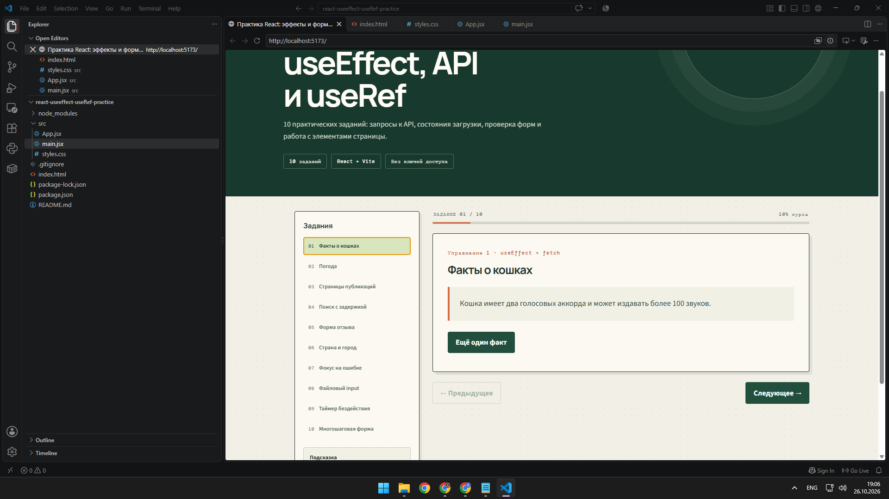
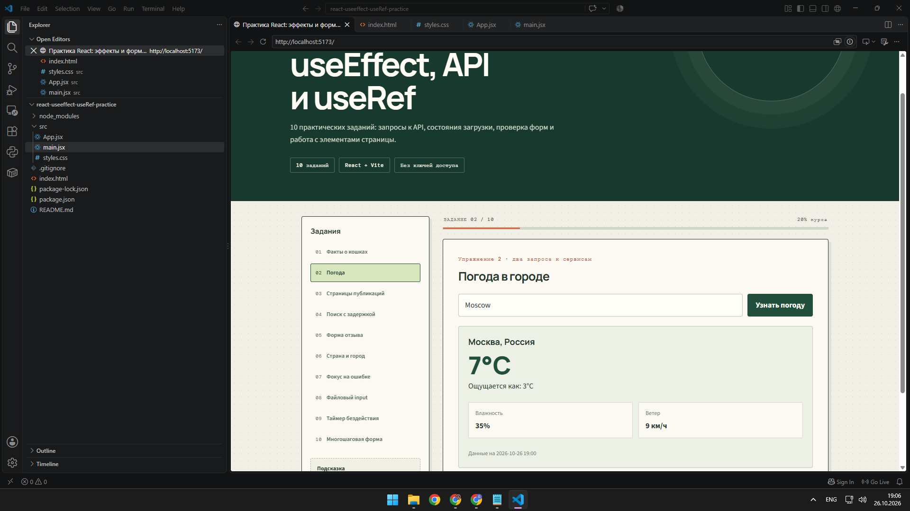
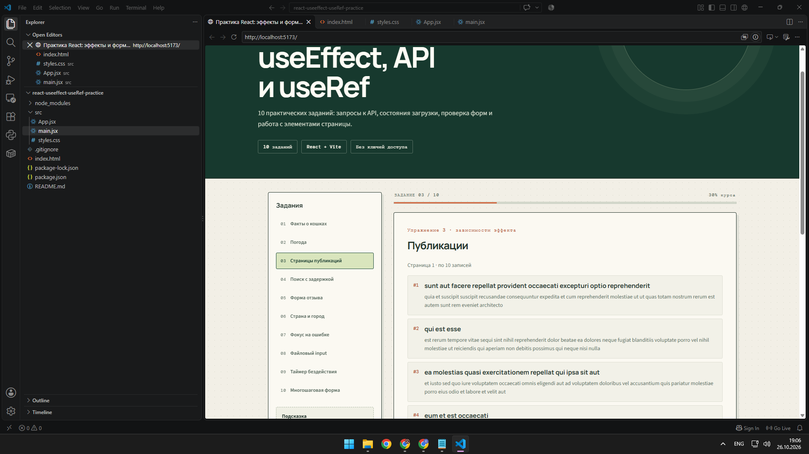
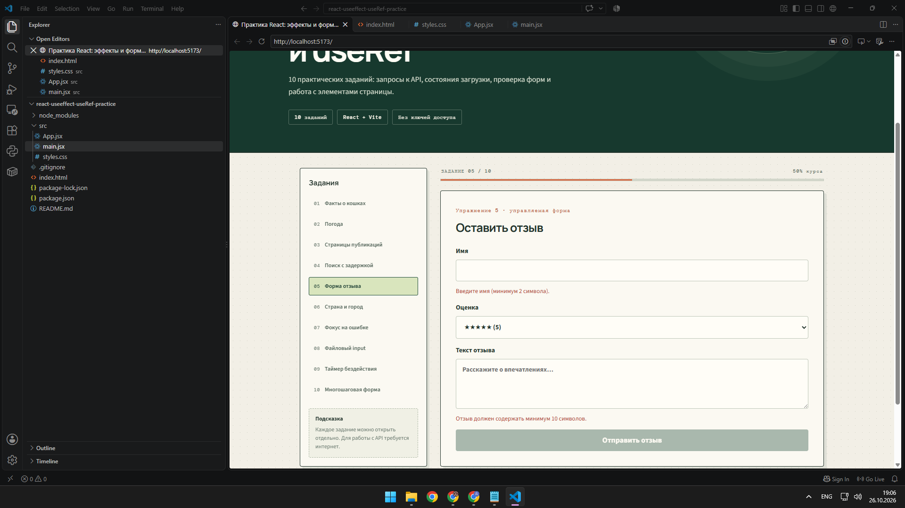
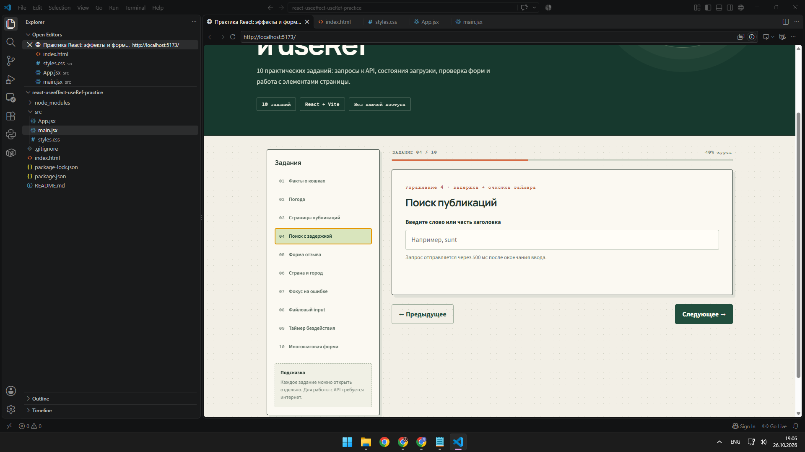
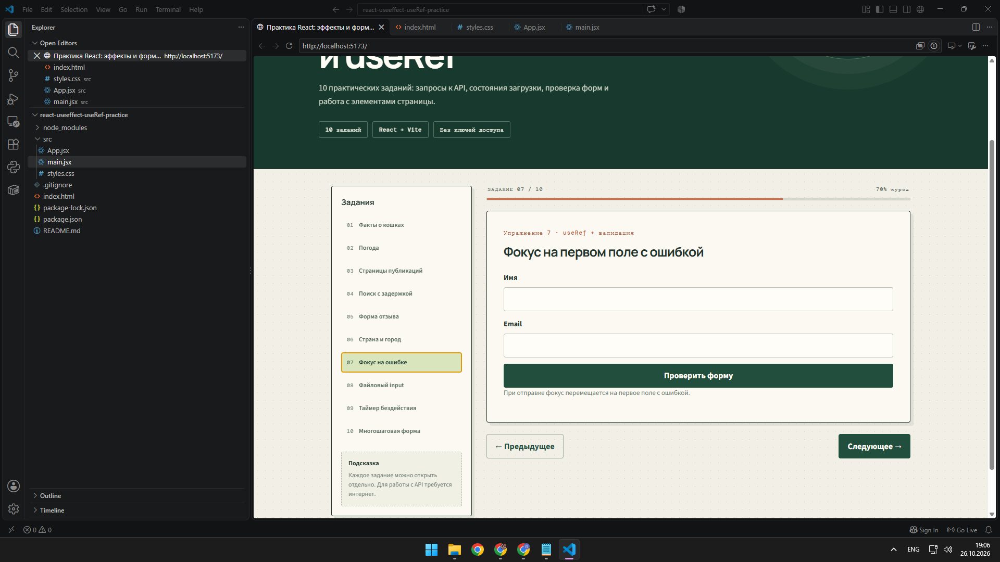
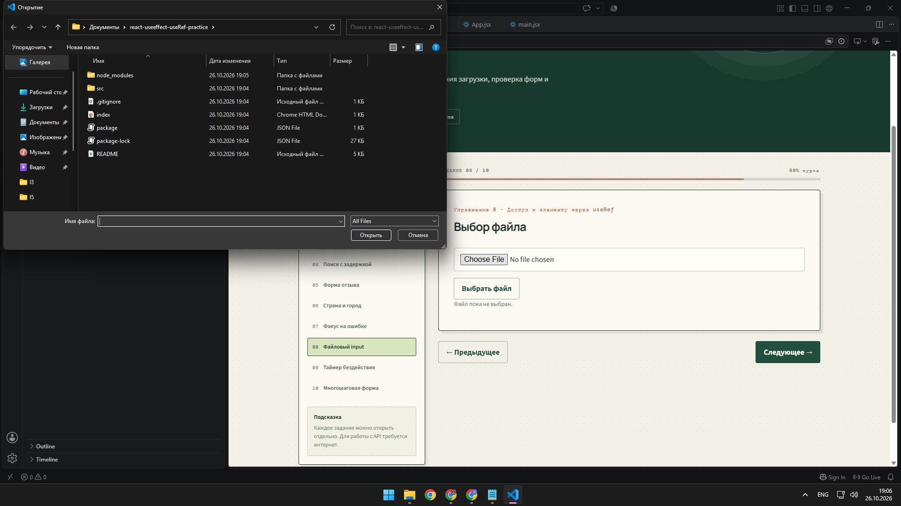

# Практика React: эффекты, API, формы и ссылки на элементы

Учебное приложение по всем 10 упражнениям из разделов «Часть 5» и «День 6». Интерфейс и документация на русском языке.

## Скриншоты приложения

Ниже — примеры интерфейса и выполненных заданий.

### 1. Факты о кошках


### 2. Погода в городе


### 3. Публикации и пагинация


### 4. Форма отзыва


### 5. Поиск с задержкой


### 6. Фокус на поле с ошибкой


### 7. Выбор файла


## Что реализовано

1. **Факты о кошках** — загрузка случайного факта, перевод на русский язык, состояния загрузки и ошибки.
2. **Погода** — поиск города и отображение текущей температуры без ключа доступа.
3. **Страницы публикаций** — загрузка записей по 10 штук, переход вперёд и назад.
4. **Поиск с задержкой** — запрос отправляется через 500 мс после окончания ввода; таймер очищается при новом вводе.
5. **Форма отзыва** — имя, оценка от 1 до 5, текст отзыва не короче 10 символов, проверка данных и сброс.
6. **Страна и город** — список городов меняется в зависимости от страны.
7. **Фокус на ошибке** — после отправки форма переводит курсор в первое поле с ошибкой.
8. **Выбор файла** — отображаются имя и размер выбранного файла.
9. **Таймер бездействия** — через 30 секунд без активности появляется подсказка; действие пользователя перезапускает таймер.
10. **Многошаговая форма** — три шага, проверка данных на каждом шаге и итоговое подтверждение.

Дополнительно: адаптация под мобильные устройства, обработка сетевых ошибок и отмена устаревших запросов там, где это необходимо.

## Требования

- Node.js версии 18 или новее (рекомендуется актуальная версия с долгосрочной поддержкой)
- npm

## Запуск на компьютере

```bash
npm install
npm run dev
```

Откройте адрес, который покажет Vite (обычно `http://localhost:5173`).

## Проверка сборки

```bash
npm run build
npm run preview
```

Готовые файлы для публикации появятся в папке `dist/`.

## Публикация на GitHub

1. Распакуйте архив.
2. Создайте новый пустой репозиторий на GitHub.
3. Откройте терминал в папке проекта и выполните команды:

```bash
git init
git add .
git commit -m "Добавлены практические задания React"
git branch -M main
git remote add origin https://github.com/ВАШ-ЛОГИН/ВАШ-РЕПОЗИТОРИЙ.git
git push -u origin main
```

Замените адрес в команде `git remote add origin` на URL своего репозитория.

## Используемые онлайн-сервисы

- Факты о кошках: `https://catfact.ninja/fact`
- Перевод фактов: `https://api.mymemory.translated.net/get`
- Поиск города: `https://geocoding-api.open-meteo.com/v1/search`
- Прогноз погоды: `https://api.open-meteo.com/v1/forecast`
- Публикации: `https://jsonplaceholder.typicode.com/posts`

Ключи доступа не требуются. Для загрузки данных нужен интернет. Перевод фактов зависит от доступности бесплатного сервиса перевода; если он недоступен, приложение покажет исходный текст факта.

## Структура проекта

```text
react-useeffect-useRef-practice/
├── src/
│   ├── App.jsx
│   ├── main.jsx
│   └── styles.css
├── screenshots/
│   ├── 01-fakty-o-koshkah.png
│   ├── 02-pogoda.png
│   ├── 03-publikacii.png
│   └── ...
├── .gitignore
├── index.html
├── package.json
└── README.md
```
